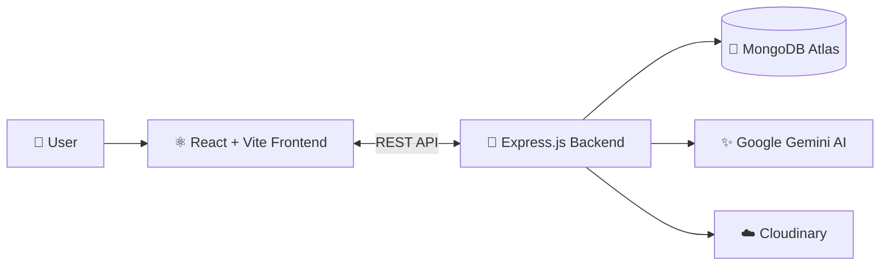

<div align="center">

# 🎯 InterviewIQ

### Practice smarter. Prepare with purpose. Interview with confidence.

**An AI-powered interview preparation platform that helps candidates practice realistic interviews, receive personalized feedback, and improve with every session.**

<br/>

[](https://interview-iq-mu-one.vercel.app)
[](https://github.com/aadarshyadav7439/InterviewIQ)

<br/>


<br/>


</div>

<br/>

<p align="center">
  
</p>


<br/>

## 🚀 About

**InterviewIQ** is a full-stack AI-powered interview preparation platform built to make interview practice more structured and personalized.

Users can choose a target company and role, create AI-powered interviews, answer questions, receive feedback and scores, manage their profile and resume, and connect with other candidates through the community.

> 💡 **Less guessing. More preparation. Better interviews.**

<br/>

## 🔗 Live Demo

<div align="center">

### 👉 [**Try InterviewIQ Now**](https://interview-iq-mu-one.vercel.app) 👈

No setup needed — the app is live and ready to explore.

</div>

<br/>

## ✨ Features

<table>
<tr>
<td width="50%" valign="top">

### 🤖 AI Interviews
- Select a **company** and **target role**
- Choose **Technical, Behavioral, or Mixed** interviews
- Select **Easy, Medium, or Hard** difficulty
- AI-generated, role-specific interview questions
- Question-wise scores and detailed feedback
- Overall interview score and final summary
- Full interview history tracking

</td>
<td width="50%" valign="top">

### 📄 Resume Support
- Upload PDF resumes
- Automatic PDF validation and text extraction
- Cloud-based resume storage via Cloudinary
- Resume metadata stored in MongoDB

</td>
</tr>
<tr>
<td width="50%" valign="top">

### 👤 Profile & Personalization
- Manage education, skills, and career goals
- Set a target company and role
- Choose from custom InterviewIQ avatars
- Avatar integration across profile & community

</td>
<td width="50%" valign="top">

### 🌍 Community
- Create and share posts
- Like helpful posts
- Comment and join discussions
- Share real interview experiences with others

</td>
</tr>
</table>

<br/>

## 🛠️ Tech Stack

| Layer | Technologies |
|---|---|
| **Frontend** | React · Vite · React Router · Tailwind CSS · Axios · Lucide React |
| **Backend** | Node.js · Express.js · MongoDB · Mongoose · JWT · Multer |
| **AI & Cloud** | Google Gemini · Cloudinary · MongoDB Atlas |
| **Deployment** | Vercel (Frontend) |

<br/>

## 🧱 Architecture



<br/>

## 🚀 Getting Started

### 1️⃣ Clone the repository

```bash
git clone https://github.com/aadarshyadav7439/InterviewIQ.git
cd InterviewIQ
```

### 2️⃣ Set up the backend

```bash
cd server
npm install
```

Create a `server/.env` file:

```env
PORT=8000
MONGODB_URI=your_mongodb_connection_string
JWT_SECRET=your_jwt_secret
GEMINI_API_KEY=your_gemini_api_key
CLOUDINARY_CLOUD_NAME=your_cloud_name
CLOUDINARY_API_KEY=your_api_key
CLOUDINARY_API_SECRET=your_api_secret
```

Start the backend server:

```bash
npm run dev
```

### 3️⃣ Set up the frontend

Open a new terminal:

```bash
cd client
npm install
```

Create a `client/.env` file:

```env
VITE_API_URL=http://localhost:8000/api
```

Start the frontend:

```bash
npm run dev
```

The app will be available at:

```text
http://localhost:5173
```

<br/>

## 🔐 Environment Variables

<details>
<summary><b>🖥️ Backend (server/.env)</b></summary>

<br/>

| Variable | Description |
|---|---|
| `PORT` | Express server port |
| `MONGODB_URI` | MongoDB connection string |
| `JWT_SECRET` | JWT authentication secret |
| `GEMINI_API_KEY` | Google Gemini API key |
| `CLOUDINARY_CLOUD_NAME` | Cloudinary cloud name |
| `CLOUDINARY_API_KEY` | Cloudinary API key |
| `CLOUDINARY_API_SECRET` | Cloudinary API secret |

</details>

<details>
<summary><b>💻 Frontend (client/.env)</b></summary>

<br/>

| Variable | Description |
|---|---|
| `VITE_API_URL` | Backend API base URL |

</details>

> ⚠️ **Never commit `.env` files or expose API keys publicly.**

<br/>

## 📁 Project Structure

```text
InterviewIQ/
├── client/
│   ├── src/
│   │   ├── assets/
│   │   ├── components/
│   │   ├── context/
│   │   ├── pages/
│   │   └── services/
│   └── package.json
│
├── server/
│   ├── controllers/
│   ├── middleware/
│   ├── models/
│   ├── routes/
│   ├── services/
│   ├── server.js
│   └── package.json
│
├── .gitignore
└── README.md
```

<br/>

## 🌱 Roadmap

- [ ] Advanced performance analytics
- [ ] Improved AI voice interview experience
- [ ] AI-powered resume scoring
- [ ] Real-time notifications
- [ ] More company-specific preparation features

<br/>

## 🤝 Contributing

Contributions, issues, and feature requests are welcome!
Feel free to check the [issues page](https://github.com/aadarshyadav7439/InterviewIQ/issues) or open a pull request.

1. Fork the project
2. Create your feature branch (`git checkout -b feature/AmazingFeature`)
3. Commit your changes (`git commit -m 'Add some AmazingFeature'`)
4. Push to the branch (`git push origin feature/AmazingFeature`)
5. Open a Pull Request

<br/>

## 👨‍💻 Author

<div align="center">

### **Aadarsh Yadav**
*Computer Science Engineering Student*

[](https://github.com/aadarshyadav7439)

</div>


<br/>

---

<div align="center">

### 🎯 Prepare with purpose. Practice with AI. Perform with confidence.

**Built with ❤️ using React, Node.js, Express, MongoDB, and AI**

⭐ **If you found this project useful, consider giving it a star!** ⭐

</div>
